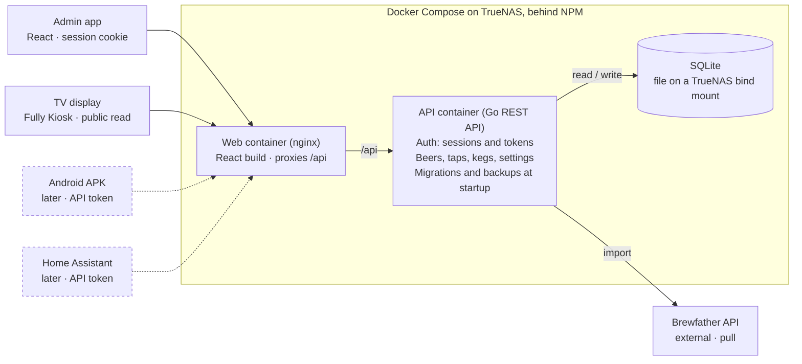

# Beer Menu — Project Brief

As of 2026-11-08 · Source of truth while drafting: [Claude Doc](https://claude.ai/artifact/X88c2GQCWXC3Sp6rvVRpXp)

## Overview

Beer Menu is a self-hosted digital tap list for a home bar, built as a free alternative to a taplist.io subscription. A Go REST API with SQLite stores the beers and taps. A React admin app manages them, and a TV display shows the current menu. Everything runs in Docker Compose on a TrueNAS server on the home network.

The API is the product: the admin UI, the TV display, and later an Android APK and Home Assistant are all clients of the same token-authenticated API.

## Goals and non-goals

The MVP is done when a TV running Fully Kiosk shows a live tap list that is managed from the admin app and seeded from Brewfather.

**MVP goals**

- Display the current tap list on a TV through a browser, readable from across the room.
- Manage beers, taps, keg levels and a "coming soon" list from a React admin app.
- Import brewed batches from Brewfather to avoid retyping beer details.
- Expose every feature through a documented REST API with proper authentication and API tokens.
- Run with a single `docker compose up` on TrueNAS, with data persisted in a volume.

**Non-goals (never)**

- Prices, ratings, ordering or payments. This is for a home, not a business.
- Multi-tenant or public cloud hosting.

**Deferred (after MVP)**

- A native Android APK for the display.
- Home Assistant integration.
- Data sources beyond Brewfather.

## Users and usage

There are two kinds of user: the owner, who manages the menu, and guests, who only read the TV.

| User | Device | What they do | Auth |
| --- | --- | --- | --- |
| Owner (admin) | Laptop or phone browser on the LAN | Add and edit beers, assign taps, update keg levels, import from Brewfather, manage API tokens | Login session |
| Display | Fire TV Stick running Fully Kiosk Browser | Shows the tap list full screen, refreshes on its own, no interaction | None: menu reads are public on the LAN |
| Guests | Look at the TV | Read the menu | None |
| Future clients | Android APK, Home Assistant | Read the menu, later update keg levels | API token |

The display must work unattended for days: it recovers from network drops and server restarts without anyone touching the TV.

## Functional scope (MVP)

The MVP covers five areas: the beer library, taps, keg levels, coming soon, and the display.

**Beer library**

- Create, edit, archive and delete beers: name, style, ABV, IBU, SRM or color, description, brewer, brew date, optional label image.
- Beers imported from Brewfather keep a link to their source batch so they can be re-synced.

**Taps**

- Configure the number of taps (at least 1, no maximum) and their order and labels.
- Assign a beer to a tap, or mark a tap empty.
- Taps hold kegs. Bottles and cans come after the MVP.

**Keg levels**

- Record keg size and volume remaining per tap.
- Update the level by hand from the admin app (pours or a direct value).
- API should allow this to also be editable, for the eventual goal of having keg scales on each keg to be able to automatically update levels after each pour.
- Show the level on the display as a fill gauge.

**Coming soon**

- Beers that are fermenting or conditioning appear in a separate "on deck" section.
- Status can follow Brewfather batch status (Planning, Brewing, Fermenting, Conditioning, Completed).

**Display**

- A full-screen, landscape view designed for a TV at 1080p, readable at 3 m or more.
- Updates without a manual reload when data changes (polling or server-sent events).
- Dark theme by default; basic theme settings (title, logo, colors) from the admin app.
- Kegs on the "on deck" section should have artwork showing the type of keg (5 gallon corny keg by default) and the color of the beer inside
- Beers on tap should have glassware artwork showing the beer's color that's on tap

## Architecture

Dashed = after MVP.

The app runs as two containers. The web container serves the React build and proxies `/api` to the API container, so the browser sees one origin. Only the Go service touches the database.

| Layer | Choice | Why |
| --- | --- | --- |
| API | Go, standard `net/http` router or a light one (chi), JSON over REST | Single static binary, small image, low memory on the NAS |
| Database | SQLite (pure-Go driver such as `modernc.org/sqlite`, WAL mode) | One file, no extra service, easy backup with TrueNAS snapshots |
| Admin app | React + TypeScript, built with Vite | Served as static files by an nginx container that also proxies `/api`; includes the `/display` route |
| Display | Browser page tuned for 1080p TVs | Runs in Fully Kiosk now; replaced by the APK later |
| API contract | OpenAPI document in the repo | Shared contract for the admin app, APK and Home Assistant |
| Deployment | Two images (`beer-menu-api`, `beer-menu-web`) built by GitHub Actions and pushed to `ghcr.io/helmnet`, when a semver release tag (`vX.Y.Z`) is pushed by hand, tagged `X.Y.Z`, `X.Y` and `latest`. A `beer-menu/docker-compose.yaml` in `truenas_apps` pins the `X.Y.Z` tag, and Dependabot opens a bump PR for each new release; a push to main there deploys through the self-hosted runner. SQLite on a bind mount under `/mnt/app/beer-menu`; containers run as the non-root UID/GID the deployer sets in `truenas_apps` | Same pattern as `github-runner` in `truenas_apps`; secrets come from repo secrets named `BEER_MENU_<VAR>` |

## Authentication and API tokens

Security is a top priority, and the repo may go public later: no secrets, credentials or private hostnames are ever committed. The API supports two credentials: browser sessions for the admin app and long-lived bearer tokens for machines.

| Credential | Used by | How it works |
| --- | --- | --- |
| Session | React admin app | Username and password login; password hashed with argon2id or bcrypt; HttpOnly, SameSite cookie; CSRF protection on writes |
| API token | Display, APK, Home Assistant, scripts | Created in the admin app; shown once; stored hashed; sent as `Authorization: Bearer <token>`; revocable; last-used time recorded |

**Rules**

- Every token has a scope: `read` (menu only) or `write` (full API). Menu reads are public on the LAN, so the TV display needs no token.
- No default credentials. The first admin is created on first run (setup screen or env var).
- Login is rate limited to slow password guessing.
- Third-party secrets (the Brewfather API key) are stored encrypted at rest and never returned by the API.
- TLS is out of scope for the app itself. It runs on the LAN. It will sit behind the NPM reverse proxy on the same TrueNAS server.

## Data model sketch

Seven tables cover the MVP. This is a starting point for the first spec, not a final schema.

| Table | Key fields | Notes |
| --- | --- | --- |
| `beers` | id, name, style, abv, ibu, srm, description, brewer, brew_date, image_path, status, source, source_ref, archived_at | `status`: planned, fermenting, conditioning, ready. `source`: manual or brewfather |
| `taps` | id, position, label, enabled | Fixed slots on the kegerator |
| `kegs` | id, tap_id, beer_id, size_l, remaining_l, tapped_at, kicked_at | One active keg per tap; history kept |
| `users` | id, username, password_hash, created_at | Multiple admins; the first is created on first run |
| `api_tokens` | id, name, token_hash, scope, created_at, last_used_at, revoked_at | Plaintext shown once |
| `integrations` | id, provider, credentials_enc, last_sync_at, settings | One row per connected source |
| `settings` | key, value | Display title, theme, units |

Volumes are stored in litres and shown in US gallons by default; the unit preference lives in `settings`. Schema changes go through versioned migrations run at startup.

### Backups

The database is one file, so backups are file copies. There are two layers: TrueNAS snapshots for routine protection, and an app-made copy before every migration.

| Layer | When | How | Covers |
| --- | --- | --- | --- |
| TrueNAS snapshots | On a schedule set in TrueNAS (for example daily, keep 14) | Snapshot task on the dataset that holds the data volume | Accidental deletes, bad edits, disk issues (with replication) |
| Pre-migration copy | At startup, only when migrations are pending | API runs `VACUUM INTO '/data/backups/beermenu-<timestamp>-v<from>.db'` before migrating; keeps the last 5 | A failed or destructive migration, especially table rebuilds |

**Rules**

- `VACUUM INTO` produces a clean, consistent copy while the app runs. A raw file copy of a live WAL database can miss recent writes.
- If the pre-migration copy fails, the API does not migrate and exits with an error. No migration runs without a backup.
- Backups contain password hashes, token hashes and the encrypted Brewfather key. Store them with the same permissions as the database.
- The key that encrypts third-party secrets lives outside the database (env var or Docker secret). Back it up separately; without it, a restore loses the Brewfather connection but nothing else.

**Restore**

1. Stop the stack with `docker compose down`.
2. Replace the database file on the volume with the backup copy.
3. Start the stack. The API re-runs any migrations newer than the backup.

Feature 1 should test this restore path once, so it is known to work before real data exists.

## Integrations

Brewfather is the first integration; the import code sits behind a provider interface so other sources can be added without touching the core.

**Brewfather (MVP)**

- Connect with a Brewfather user ID and API key, entered in the admin app.
- List batches and import selected ones as beers: name, style, ABV, IBU, color, brew date, notes, batch status.
- Re-sync an imported beer on demand to pick up changes, such as final ABV after fermentation.
- Import is pull-only, run on demand or on a schedule set in the admin app.
- Respect Brewfather's API rate limits and cache responses. Details from memory, approximate: v2 API, Basic auth with user ID and key, about 500 calls per hour. Verify against the current Brewfather docs in the spec.

**Provider interface**

- A Go interface such as `ListBatches()` and `GetBatch(id)` returning a common batch type.
- Each provider maps its data to that type; the core never sees provider-specific fields.
- Later candidates: BeerSmith, Grainfather, Untappd, or a CSV import.

## Roadmap

Four phases, each usable on its own. A phase starts only when the one before it runs on TrueNAS.

1. **MVP: web tap list.** API, admin app, TV display, Brewfather import, Docker Compose deployment.
2. **Home Assistant.** A custom integration or REST sensors that read taps and keg levels, and service calls to update levels. Uses `write`-scoped API tokens; no API changes expected.
3. **Android display APK.** A Fire TV app that replaces Fully Kiosk: auto-start on boot, discovery of the server on the LAN, offline last-known menu.
4. **More sources and polish.** Additional import providers, flow-meter or scale input for automatic keg levels, multiple display layouts, a bottles and cans list.

## Spec-kit feature breakdown

Run `/speckit-constitution` once from this brief, then one `/speckit-specify` per feature below, in order. Each feature ends in something testable.

| # | Feature | Depends on | Done when |
| --- | --- | --- | --- |
| 0 | Constitution | None | Principles recorded: API-first, Go + SQLite, React, tests required, LAN security baseline, well-documented but not verbose code (doc comments on every exported Go symbol, API handler and React component; inline comments explain why, never restate what the code does) |
| 1 | Project skeleton and deployment | 0 | Go API and React app build in Docker; pushing a `vX.Y.Z` tag publishes both images to GHCR; `docker compose up` serves a health endpoint and a blank admin page; SQLite on a volume with migrations |
| 2 | Authentication and API tokens | 1 | First-run admin setup, add and remove admins, login and logout, token create, list and revoke, `read` and `write` scopes enforced |
| 3 | Beer library | 2 | Beer CRUD in API and admin app, image upload, archive |
| 4 | Taps and kegs | 3 | Configure taps, put a keg on a tap, update and kick kegs, keg history |
| 5 | TV display | 4 | Full-screen tap list with keg gauges and coming soon; live updates; works in Fully Kiosk on a Fire Stick |
| 6 | Brewfather import | 3 | Connect account, list batches, import, re-sync and scheduled sync; status feeds coming soon |
| 7 | Display settings | 5 | Title, logo, theme and units editable from the admin app |

Features 5 and 6 are independent and can run in either order. An OpenAPI spec is kept in the repo from feature 1 onward so later clients (APK, Home Assistant) have a contract.

## Open questions

None open. Answers are recorded in the sections above.
